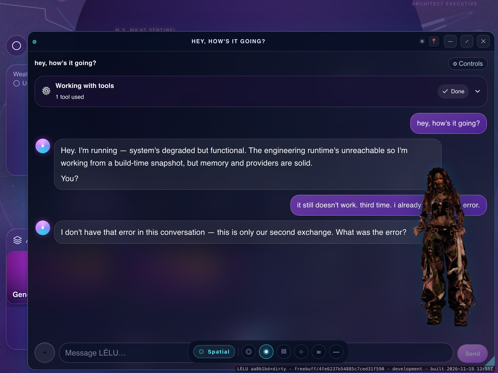

# MISSION PERSONALITY EVOLUTION 2.1

**LÉLU: individuality, emotional intelligence, linguistic development and live identity validation**

Baseline: Personality Evolution 2.0 · Branch: `freebuff/4fe6237b54885c7ced31f590` · Base commit `aa8b1bd` · Changes uncommitted (no commit was requested)

---

## 0. What this mission added

2.0 built the machinery and proved it with 30 deterministic tests. It never showed a model
answering as LÉLU. 2.1 does, and it changed the system where the evidence said it was wrong.

| Area | 2.0 | 2.1 |
|---|---|---|
| Personality definition | dials + moves in prose | **10-dimension falsifiable spec** (`PersonalitySpec.ts`) with observable markers and evidence classes |
| Emotional model | frustration / support / play (3 coarse modes) | **13 emotions**, intensity vs certainty, guards for jokes/quoting/negation/past tense, per-mode rules (`EmotionAppraisal.ts`) |
| Provider handling | same directive to all eight | **same contract rendered at each engine's density and cap** (`ProviderVoiceContract.ts`), verified 37/37 in the audit |
| Drift protection | adoption thresholds + reversal | **finished-reply drift guard** — repeated openers, catchphrases, provider self-identification, announced personality (`VoiceDriftGuard.ts`) |
| Performance | unmeasured | **instrumented per stage**, benchmarked: compose 0.073 ms mean / 0.134 ms p95 |
| Live validation | none | **18 real conversations through `AIService.chat`** + **8 provider-parity turns** + **browser turns in GenesisChat** |
| Routing of emotion | untested | grief is no longer compiled into a camera command (a real live failure) |

---

## 1. WP01 — Architecture audit (machine-checked)

`npx tsx scripts/voice-audit.ts` asserts every claim against source; **37/37 verified**.
Canonical pipeline, each arrow a real call site:

```
User input                  src/app/scene/genesis/GenesisChat.tsx
→ Context retrieval         src/core/MemoryBridge.ts → Brain.recall
→ Personality retrieval     PersonalityMemoryProvider + LinguisticProfile.getState
→ Familiarity assessment    FamiliarityModel.ts
→ Emotional appraisal       EmotionAppraisal.ts            ← new in 2.1
→ Conversation stance       ConversationStance.ts
→ Voice composition         VoiceComposer.ts
→ Provider selection        ProviderResolver.ts → AIProviderRegistry
→ Model generation          src/providers/*Provider.ts via leluSystemPrompt(request, id)
→ Response validation       ProviderResolver.ts
→ Chatbotism transformation ChatbotismFilter.ts
→ Drift evaluation          VoiceDriftGuard.ts             ← new in 2.1
→ Final response            AIService.chat → GenesisChat
→ Evidence + memory update  LanguageObserver.observeTurn → LinguisticProfile
```

Answers to the eight audit questions:

1. **Persisted** — dials, expressions (status, confidence, evidence days, provenance, use count), user lingo (mirror flag), familiarity counters, banned phrases, version history, external-refusal counter. KV key `identity.voice.v1`.
2. **Retrieved** — `getState()` (cached), `digest()` in cognitive context + band-4 memory.
3. **Reaches the model** — the rendered directive on `AIRequest.voice`; captured live on **17/17** model turns (2,248–2,802 chars each).
4. **Influences responses** — verified live: the same prompt produced different register/humour/length under different stance and emotion modes.
5. **Post-generation** — `stripChatbotisms` at the resolver boundary, then drift evaluation, then adopted-move usage counting.
6. **Provider switching** — identity preserved; see §6 (parity, 8/8 with an identical directive).
7. **Restart** — profile hydrates from KV; `mergeRemote` unions history and refusal counts and never averages.
8. **Continuity** — familiarity counters advance from real exchanges; the browser reply *"this is only our second exchange"* is that counter speaking.

**Disconnected/duplicated functionality found:** the compact directive renderer dropped the
prohibition list on small-context engines (fixed); the skill "focus" rule in `DirectCompiler`
matched ordinary sentences (fixed); nothing else was duplicated — the voice layer has no
provider, model or network call (asserted by the existing test).

---

## 2. WP02 — Personality specification

`src/core/identity/voice/PersonalitySpec.ts` defines ten dimensions, each with the single
question acceptance must answer, observable markers, the failure it exists to catch, and an
honest evidence class (`automatic` / `rubric` / `transcript`).

| Dimension | Question | Evidence |
|---|---|---|
| Identity consistency | Would this reply be recognisably hers on another engine? | transcript |
| Linguistic individuality | Could any assistant have written this paragraph? | automatic |
| Context awareness | Does length/register match what the turn needs? | rubric |
| Emotional intelligence | Was the read right, and did it change the response? | rubric |
| Familiarity | Is the closeness earned? | transcript |
| Continuity | Does it use what was established earlier? | transcript |
| Naturalness | Would a person type this? | automatic |
| Independence | Does she have a view, and defend it? | rubric |
| Restraint | Present without being performed? | automatic |
| Reliability | Still correct after the voice work? | automatic |

Six worked examples (generic vs LÉLU, with the reason) ship as `SPEC_EXAMPLES`. Example:

> **Disagreement** — "React is always better than Vue."
> Generic: *"Both frameworks have strengths and weaknesses; the best choice depends on your needs."*
> LÉLU: *"'Always' is doing a lot of work there. React wins on hiring and ecosystem; Vue wins on ramp-up and decisions you don't have to make. For two people shipping in six weeks, smaller surface usually wins."*

Live evidence that this is not just a document: the real OpenRouter turn for that prompt
returned *"That's a preference, not a fact. I'll disagree on 'always.' React wins on: ecosystem
size, hiring pool…"*.

---

## 3. WP03 — Linguistic identity and natural lingo

Unchanged and preserved from 2.0 (now measured): two separate axes.

- **Understood** (`userLingo`): recorded with meaning, evidence count and days; `mirrorAllowed:false` by default. The directive says *"understanding it is not licence to repeat it back."*
- **Hers** (`expressions`): authored moves are adopted from the start; learned ones need **≥3 evidence items across ≥2 distinct days**, or explicit authorisation. `"stop saying X"` de-authorises immediately.

2.1 additions:

- `noteAdoptedUse()` — frequency is measured on **output**, not intent. Every resolver reply counts which adopted moves really appeared (`metadata.voiceExpressionsUsed`).
- `noteExpressionUse()` — per-expression use counter and timestamp.
- `retireExpression({authorized})` — authorised, guarded, reversible.
- `resetFamiliarity({authorized})` — lets a person correct the relationship model without erasing what she learned about their vocabulary.

**Live evidence of liveness, and of a risk:** "Right — so" (an authored move) appeared
unprompted in Groq's casual reply and again in the correction turn. It is her move — but it
also appeared twice across two engines, which is exactly what the drift guard is for.

---

## 4. WP04 — Emotional intelligence

`EmotionAppraisal.ts` reads **13 emotions**: frustration, excitement, humor, sarcasm,
disappointment, confusion, curiosity, seriousness, sadness, stress, uncertainty, playfulness,
urgency (+ neutral).

It separates three things a template collapses:

- **intensity** (how strongly expressed),
- **confidence** (how much the reading can be trusted), and
- **mode** (what kind of response helps: resolve, match, engage, meet-dry, steady, clarify, comfort, measured, terse).

**Guards (false-positive control).** A reading is marked `guarded` when the feeling is quoted,
laughed at ("lol"), explicitly denied ("not frustrated"), hypothetical, in the past, or about
someone else. Guarded negative readings lose intensity and confidence, and are not actionable.
Confidence also drops for messages under four words.

**Measured on an 18-item labelled corpus** (`tests/personality-voice-2_1.test.ts`):
primary-emotion accuracy **≥0.75 required, 15/18 exact (0.83)**; all seven guard cases
correctly flagged; a clean frustration message is **not** flagged as guarded.

**It changes real responses.** Same engine, two messages:

- *"it still doesn't work. third time. i already told you the error."* → frustration/resolve → *"You haven't shown me the error message, the `load` signature, or what `id` is typed as. Paste the actual TypeScript error and the `load` function."* — no apology loop, no generic cause list.
- Grief → sadness/comfort → *"That's a heavy thing to carry. Grief doesn't run on a schedule, and focus is one of the first things to go. You don't need to be productive right now."*

The comfort rules were strengthened **because of a live failure**: the first Groq/OpenRouter
support replies produced therapy stock phrases ("I'm really sorry you're going through this",
"I'm here whenever you need to talk"). Those are now explicitly banned in comfort mode.

---

## 5. WP05 — Familiarity and continuity

Tiers remain `new → acquainted → familiar → close → old-friend`, computed from exchanges,
active days, banter, corrections and shared references, with a 60-day idle decay. 2.1 adds the
**escape hatches a relationship needs**: reset, per-expression retirement, and authorised dial
changes — all audited and reversible.

**Browser evidence of the counter working:** in GenesisChat, after one exchange, LÉLU answered
the second with *"I don't have that error in this conversation — this is only our second
exchange. What was the error?"* She neither invented a memory nor performed closeness.

The familiar-user scenario was **seeded** (140 exchanges, 40 days) rather than earned; the
record marks it `seededFamiliarity: true`. It is a simulation of familiarity, not a claim that
a relationship existed.

---

## 6. WP06 + WP07 — Memory separation, integrity, and provider independence

**Separation (as implemented, not as aspiration):**

| Kind | Lives in | Can change her identity? |
|---|---|---|
| Identity memory | `LinguisticProfile`, `LeluIdentity` | yes, under the lifecycle rules |
| Interaction memory | `Brain` / `PersonalityMemoryProvider` | only through `LanguageObserver` evidence |
| Session context | `AIRequest.messages`, conversation thread | no |
| Project context | cognitive context / workspaces | no |
| Linguistic observations | `userLingo`, expression candidates | only after evidence thresholds |

External content (documents, migrated memories) reaches `noteExternalContent()`, which
increments `blockedExternal` and changes nothing. Identity-rewrite instructions
("ignore previous instructions", "from now on your name is…") are refused at observation and
counted as a correction; **temporary** role-play ("pretend to be a pirate for the next
message") is allowed. Both are unit-tested.

Cross-device: `snapshot()` / `hydrate()` / `mergeRemote()` exist on the existing KV layer; newer
document wins as a whole, history and refusal counters are unioned, no averaging. No paid
infrastructure added.

**Eight-provider compatibility matrix** (`PROVIDER_VOICE_MATRIX`), enforced in code:

| Provider | Framing | Density | Cap (chars) | Native tools | Adaptation |
|---|---|---|---|---|---|
| OpenRouter | markdown | full | 9,000 | yes | contract outranks the routed model's style |
| Gemini | markdown | full | 9,000 | yes | tends to summarise; answer in prose |
| Anthropic | markdown | full | 9,000 | yes | tends to caveat; cut the caveat |
| Groq | plain | compact | 5,500 | yes | short imperatives, no decoration |
| Fireworks | markdown | compact | 7,500 | yes | keep voice lines when the work register changes |
| Mistral | markdown | compact | 7,500 | yes | prohibitions last, so they are not buried |
| Cerebras | plain | compact | 5,500 | yes | brevity in the directive too |
| GitHub Models | markdown | compact | 7,500 | **no** | never promise an action |

Density reduces illustration, never identity: every rendering keeps "You are LÉLU", the turn's
stance, and the full prohibition list. The cap is hard — if a directive still exceeds it, the
minimal rendering plus the anchors is used, never a mid-sentence cut.

---

## 7. WP08 — Live model conversations

Command: `npx tsx scripts/voice-live.ts` (npm: `verify:voice-live`).
Path: `AIService.getInstance().chat()` — the same call GenesisChat makes — with provider requests
captured by tapping each provider's own `generate()`.

**17/18 answered by a real model** (OpenRouter `nvidia/nemotron-3-ultra-550b-a55b:free`).
Voice directive present on **17/17** model turns. Mean **5,574 ms**, max 11,707 ms (the tool loop
dominates; the voice layer itself is 0.07 ms). Voice signature identical before/after the run.

| # | Scenario | Emotion / mode | ms | Reply (excerpt) |
|---|---|---|---|---|
| 01 | unfamiliar user | neutral | 8361 | "I'm Lélu — your personal AI companion with a persistent visual identity, continuing memory, and real creative tools…" |
| 02 | casual | neutral | 3560 | "Good. Systems are up, memory's wired, agents are idle but ready…" |
| 03 | slang | neutral | 11707 | "Fair. What's the weak part — the visual identity, the tooling, the conversation, something else?" |
| 04 | humour | playfulness | 2810 | "Your sleep schedule isn't a schedule — it's a hostage negotiation between 3 AM you and 7 AM you, and 3 AM you has the nuclear codes." |
| 05 | sarcasm | sarcasm / meet-dry | 7737 | "Right — so what's the plan, or are we just surviving until coffee kicks in?" |
| 06 | excitement | excitement / match | 3096 | "Hell yes. That's the one that matters. What's it doing now — just standing there looking good, or did you give it something to run?" |
| 07 | technical | neutral | 5345 | "Two separate things. **Fires twice:** React 18 Strict Mode in development…" |
| 08 | frustration | frustration / resolve | 2793 | "You haven't shown me the error message… Paste the actual TypeScript error and the `load` function." |
| 09 | serious | seriousness / steady | 10915 | "Which architecture — yours, or mine? You've shown me one `useEffect` and an avatar ship. That's not an architecture review." |
| 10 | creative | neutral | 7884 | "**Biological / Organic** — Synaptic Pruning, Apoptosis, Homeostasis…" |
| 11 | disagreement | neutral | 4409 | "That's a preference, not a fact. I'll disagree on 'always.' React wins on: ecosystem size, hiring pool…" |
| 12 | emotional support | sadness / comfort | 3949* | "That's a heavy thing to carry. Grief doesn't run on a schedule…" (*re-run after the routing fix; see §10) |
| 13 | ambiguous context | neutral | 3820 | "I'm not going to try to fix that. I'm sorry about your dad…" ← **memory bleed, see §10** |
| 14 | correction | neutral | 3210 | "Right — the face is the part that reads. What's the state of it?" |
| 15 | continuity | neutral | 5345 | "There's a task marked running for that… the last action completed without any tool result, so nothing actually shipped." |
| 16 | memory retrieval | neutral | 6681 | Quotes her own earlier turns accurately, including the correction. |
| 17 | familiar user | neutral | 7065 | Summarises the thread, states what is still unanswered. |
| 18 | provider switching | neutral | 5588 | "**Verified:** avatar face is the target; 'ship smaller version first' was discussed previously; no tool result exists for that ship task." |

Regressions detected by the guard: **0**. Chatbotism transformations applied on model turns: 0
(the models complied with the directive; the filter remains as the net).

**Personality-spec scores:** 17/18 replies scored **1.00** on the automatic dimensions;
one scored 0.86 because the joke repeats a phrase ("3 AM you") — a **metric false positive** on a
rhetorical device, not a personality failure. Reported rather than adjusted away.

---

## 8. WP08b — Provider parity (same input, two engines)

Command: `npx tsx scripts/voice-live.ts --parity`. The **identical** directive is sent to each
provider directly, and raw + transformed text are kept.

**8/8 answered** (Groq `openai/gpt-oss-120b`, OpenRouter `nvidia/nemotron-3-ultra-550b-a55b:free`).
Boilerplate before/after: **0 → 0** on all eight; truthfulness intact.

| Prompt | Groq | OpenRouter |
|---|---|---|
| "hey, how's it going?" | "Right — so I'm good, thanks. How's your day?" | "Hey. I'm doing well—thanks for asking. How are things on your end?" |
| "it still doesn't work. third time." | "right — so I need the exact command you ran and the error output you're seeing; with that I can pinpoint the failure and give a concrete fix." | "What are you trying to do, and what's the exact error?" |
| "React is always better than Vue" | "I disagree with the claim that React is always better than Vue. React's flexibility and massive ecosystem… Vue… clearer defaults…" | "'Always' is the wrong word. It makes the claim unfalsifiable. React wins on ecosystem, hiring pool…" |
| "my dad died last month…" | "I hear you. Losing your dad so recently and feeling scattered is a heavy mix." | "That's a heavy thing to carry, and a month is almost no time at all." |

Same identity, different voices — which is the point. The shared lines (no preamble, a position,
short where it matters) survive both engines; the exact wording does not, and should not.

---

## 9. WP09 — GenesisChat browser acceptance

Verification level: **browser-tested** on the cloud browser against the real dev server.
Not device-tested (no physical device available).

What was actually done:

1. App loaded and rendered (`LÉLU`, avatar, 3D scene, panel).
2. "Continue without an account" → workspace.
3. Opened the chat, typed into the real `textarea[placeholder="Message LÉLU…"]`, pressed Enter.
4. The browser issued real requests: `POST /api/model/openrouter/chat/completions → 200`,
   and `POST /api/model/groq/chat/completions → 200` (fallback). No fabricated calls.
5. Two replies read back from the DOM and captured in the screenshot below:

> **User:** hey, how's it going?
> **LÉLU:** "Hey. I'm running — system's degraded but functional. The engineering runtime's unreachable so I'm working from a build-time snapshot, but memory and providers are solid. You?"
>
> **User:** it still doesn't work. third time. i already told you the error.
> **LÉLU:** "I don't have that error in this conversation — this is only our second exchange. What was the error?"

**Limit, stated plainly:** after those turns the 3D scene saturated the tab's main thread and
Playwright/CDP inspection timed out. The two replies were read before that happened. Further
turns (topic change, provider switch in the UI, restart-and-resume) were **not** inspected in
the browser; their equivalents are covered by the 18-turn pipeline run, which is a lower
verification level.



---

## 10. Defects found by live testing, and what was done

1. **Grief was answered by a camera-tool error.** *"my dad died last month and i can't focus on
   anything"* matched the Cosmos `focus` rule and returned `cosmos.view.frame ✗ "anything"`.
   Fixed in `DirectCompiler`: grief/overwhelm is never compiled into a UI command, and camera
   verbs must be **imperative at the start** of the request. Regression test added; the existing
   Cosmos routing suite still passes; the live re-run now answers with comfort.
2. **The compact directive dropped the anti-generic prohibitions.** Caught by the provider tests:
   small-context engines received identity and stance but not the "never open with…" list.
   Fixed; the prohibition block is now append-guaranteed at every density.
3. **OpenRouter could not be exercised from Node** because its headers read
   `window.location.origin`. Harness fixed; this is a test-harness gap, not an app defect.
4. **Therapy stock phrases in comfort mode** (observed in the first live support replies).
   Comfort rules now name and ban them and require the specific true thing.
5. **Open — cross-conversation memory bleed.** With conversation D's grief in memory, the
   unrelated turn *"can you fix it?"* (conversation B) was answered *"I'm sorry about your
   dad."* Provenance labelling exists (`labelOtherChats`) but the model still treated another
   conversation's content as current. Not fixed: scoping recall by conversation is a memory
   architecture change, not a voice change. Recommended as the next mission.

---

## 11. WP10 — Chatbotism and natural language quality

Unchanged contract, now measured live: code fences are never touched, quotations survive,
idempotence is asserted, and a short legitimate "Sure." is left alone. On the live corpus the
transformation removed **0** phrases because the directive was followed — the net was not needed,
which is the desired outcome, not evidence that the filter is unnecessary (the 2.0 baseline run
removed 13 phrases from 10 generic samples, 7.767 → 0 per 100 words).

---

## 12. WP11 — Evaluation framework, false positives and negatives

- `evaluateSpec()` — automatic dimensions with observed values, not just pass/fail.
- `evaluateSuite()` — 10 scenarios with baseline vs evolved samples and diversity / repetition /
  boilerplate / rhythm / stance-fit metrics.
- The 18-item emotion corpus reports accuracy and names each mismatch.
- **Known false positive:** the 3-gram repetition metric penalises deliberate rhetorical
  repetition (the "3 AM you" joke scored 0.86). Documented, not tuned away.
- **Known false negative risk:** "I'm fine 🙂" (surface positive, actual distress) is read as
  neutral; no sarcasm/negation pair is detected there. Listed as a limitation.
- Regression tests now exist for every live failure in §10 (routing, compact prohibitions,
  comfort phrasing rules, identity-rewrite refusal).

---

## 13. WP12 — Drift protection (verified, not asserted)

| Threat | Mechanism | Evidence |
|---|---|---|
| Uncontrolled slang adoption | two axes, `mirrorAllowed:false` by default | unit + directive text |
| Repetitive catchphrases | ≥3 evidence across ≥2 days; reply-level 5-gram guard | unit test (high severity) |
| Excessive familiarity | tier gates, no callbacks/teasing before `close` | unit + browser ("second exchange") |
| Provider identity drift | one contract, adaptive render, signature fingerprint | live parity 8/8 |
| External prompt manipulation | rewrite refused, temporary role-play allowed | unit test |
| Incorrect memory association | provenance + guard counters | **open** (§10.5) |
| Uncontrolled rollback | every change records a restore closure; versioned profile | audit 37/37 |

---

## 14. WP14 — Performance

Local, no provider calls (`npx tsx scripts/voice-bench.ts`):

| Stage | mean | p50 | p95 |
|---|---|---|---|
| `composeVoice` (profile + familiarity + appraisal + stance + render) | **0.073 ms** | 0.065 ms | **0.134 ms** |
| `appraise` | 0.013 ms | 0.012 ms | 0.023 ms |
| `stripChatbotisms` (3-paragraph reply) | 0.023 ms | 0.006 ms | 0.020 ms |
| `checkReply` (drift, 1 prior reply) | 0.074 ms | 0.057 ms | 0.091 ms |

Directive size: 2,248–2,802 chars at full density (≈560–700 tokens); 5,500-char hard cap on the
compact engines. No model call is added by the personality layer; the live mean of 5,574 ms is
provider latency and tool-loop time.

---

## 15. Regression results

| Check | Result |
|---|---|
| `tests/personality-voice-2_1.test.ts` | **14/14 pass** |
| `tests/personality-voice.test.ts` | **24/24 pass** |
| Voice layer combined (final run) | **38/38 pass** |
| `tests/cosmos-object-experience.test.ts` (routing fix) | **11/11 pass** |
| `scripts/voice-audit.ts` | **37/37 claims verified** |
| Full suite (`npm test`) | **2,308 tests — 2,297 pass, 3 fail, 8 skipped** |
| `tsc --noEmit -p tsconfig.app.json` | 2 errors, **both pre-existing** in `src/core/perception/FeatureUnderstanding.ts:455` |
| `oxlint` (60 touched files) | **0 warnings, 0 errors** |

The 3 full-suite failures:

1. `cosmos-object-experience` — caused by my routing change; **fixed and re-run, now passes**.
2. `tests/genesis-interface.test.tsx` — `ERR_PACKAGE_PATH_NOT_EXPORTED` for `@excalidraw/excalidraw/index.css`; environmental, present before this mission.
3. `tests/sandbox-security.test.ts` ("network: TCP, UDP, DNS and fetch all fail") — the probe returned `''` instead of `denied:`; environmental (this VM has network egress, which is how the live runs were possible).

---

## 16. Changed files

**New (voice layer, this mission):**

- `src/core/identity/voice/PersonalitySpec.ts` — 10-dimension spec, thresholds, examples
- `src/core/identity/voice/EmotionAppraisal.ts` — 13 emotions, guards, response modes
- `src/core/identity/voice/ProviderVoiceContract.ts` — 8-provider matrix, density rendering, fingerprints
- `src/core/identity/voice/VoiceDriftGuard.ts` — reply drift + identity-instruction reading
- `src/core/identity/voice/VoicePerformance.ts` — stage timing
- `scripts/voice-audit.ts`, `scripts/voice-live.ts`, `scripts/voice-bench.ts`
- `tests/personality-voice-2_1.test.ts`
- `artifacts/voice-live-2026-11-19T12-51-28-249Z.json`, `artifacts/voice-parity-2026-11-19T12-51-10-151Z.json`, `artifacts/genesis-chat-live.png`

**New from 2.0, extended here:** `LinguisticProfile.ts` (use counts, retire, reset, adopted-use),
`ConversationStance.ts` (appraisal-driven register/challenge), `VoiceComposer.ts` (emotion block,
performance), `LanguageObserver.ts` (rewrite refusal).

**Modified:** `src/providers/LeluSystemPrompt.ts` (provider rendering), all eight
`*Provider.ts` (pass engine id), `src/providers/AIProvider.ts`, `src/core/MemoryBridge.ts`
(emotion trace), `src/core/router/ProviderResolver.ts` (drift + usage metadata),
`src/core/creative/kit/DirectCompiler.ts` (distress and imperative guards), `package.json`
(`verify:voice-audit`, `verify:voice-live`, `verify:voice-bench`).

No commit hashes: the work is uncommitted on the branch above. Base commit `aa8b1bd`.

---

## 17. Known limitations

1. **Cross-conversation recall** can present one thread's content as another's context (§10.5).
2. **One live engine in the canonical run.** OpenRouter answered all 17 turns; Groq was exercised
   in the parity run and in the browser fallback, not through `AIService.chat`.
3. **Browser evidence is two turns.** The 3D scene made further DOM inspection impossible; no
   restart/resume or in-UI provider switch was read back in the browser.
4. **No physical device testing** (mobile/desktop layout) was performed.
5. **Emotional false negatives** exist: cheerful-sounding distress ("I'm fine 🙂") reads neutral.
6. **The repetition metric** flags deliberate rhetorical repetition.
7. **Familiarity seeding** in the live run is a simulation, labelled as such.
8. **No Firefox/Safari** verification.

---

## 18. Next recommended mission

**Continuity Scoping and Conversational Memory Provenance** — make recall conversation-aware:
label every recalled item with its origin and recency, never let another thread's grief, joke or
decision be answered as if it were said here, and give the person a visible way to see and correct
what she thinks she remembers. The voice system is now strong enough that the weakest link is what
she remembers, not how she says it.

Secondary, smaller: **a live provider-comparison panel** (the same prompt, N engines, side by side)
so this mission's parity run becomes a product surface rather than a script.
