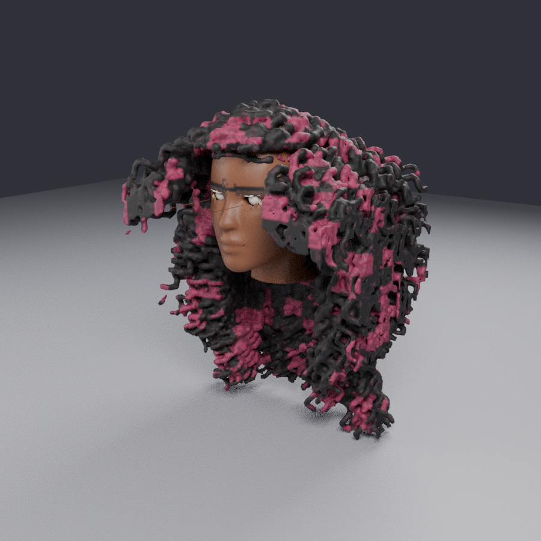
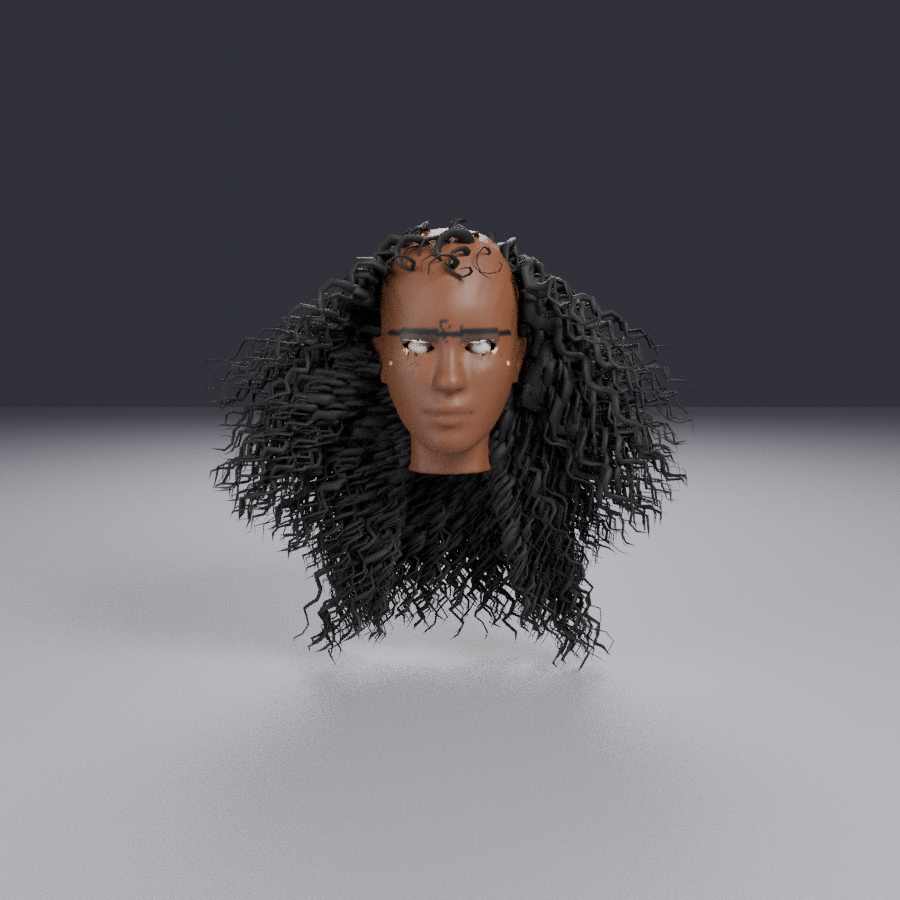

# LÉLU 2.1 — Geometry fidelity and mathematical validation

Branch `experiment/lelu-2-golden-geometry` (isolated worktree `lelu2/`). Claude's
branch `claude/mission5-lelu-asre-integration-mm6xau` is untouched at `55c89aae`;
the 2.1 commits sit on top of LÉLU 2.0 (`2a645e23`).

Every number below is re-readable from the JSON named beside it, and the claim
layer ([`src/core/asre/lelu2/claims.ts`](../../src/core/asre/lelu2/claims.ts))
now refuses a claim its own file contradicts.

---

## WP01 — The audit corrected the 2.0 report

`npx tsx scripts/asre/lelu2/audit.ts` → [`audit.json`](audit.json), and
`tests/claims.test.ts` (8 cases) proves the guard fires on each failure mode:
swapped labels, a CV that went up, a confounded sample size, a metric that does
not describe one of the layouts, a descriptive number dressed up as a win.

| 2.0 statement | audit verdict |
|---|---|
| "hair root CV 1.345 → 0.643" | **retracted**: 928 vs 1350 roots. A nearest-neighbour CV depends on n. The equal-n replication (WP02) gives **0.3925 → 0.0968 at n=800**, which is the number now quoted. |
| "bead spacing CV 0.166 → 0.030" | **holds** (both n=34, same file, values re-read from `comparison.json`) |
| "bead max/min 1.68 → 1.16" | **holds** |
| "mean bead spacing 17.8 → 15.9 mm" | **holds, but not a win** — a different ring radius, marked descriptive |
| "divergence 27.5° → 137.5°" | **retracted**: a concentric-ring layout has no spiral turn to recover |
| "radial exponent 0.432 → 0.490" | **retracted**: three discrete rings fit a power law badly by construction |
| "curl radius decays by 1/φ" | **wrong as written**: the 2.0 code passed `growth = 1/φ` across the whole strand, i.e. **1.09× per turn**, not φ per turn. Measured now: a true 1/φ-per-turn ringlet gives log-radius **R² = 1.000**; the 2.0 parameterisation does not. |

## WP02 — Five laws, four real surfaces, one budget

800 points, one seed, identical index, identical cloud. `artifacts/lelu2/matrix/summary.json`.

| surface | A stride | B Fibonacci | C Vogel | D one-arm spiral | E hybrid | decision |
|---|---|---|---|---|---|---|
| hair roots (20 910 pts) | CV 0.3925, cov 99.9 % | 0.4090, 86.2 %, 16 dup | 0.4225, 85.8 %, 18 dup | 0.1852, **8.4 %** | **0.0968, 100 %** | retain **E** |
| garment surface (42 370 pts) | 0.3943, 99.6 % | 0.7088, 85.2 % | 0.7527, 85.2 % | 0.2702, **7.5 %** | **0.0885, 100 %** | retain **E** |
| diadem disc (59 356 pts) | 0.4092, 100 % | n/a (planar) | **0.0382, 100 %** | 0.0000, **22.7 %** | 0.0998, 100 % | retain **C** |
| sphere r=50 mm (24 000 pts) | 0.0519, 100 % | **0.0277, 100 %** | 0.0299, 100 % | 0.0069, **11.2 %** | 0.0962, 100 % | retain **B** |

What this settles: **there is no universal law.** Fibonacci directions win on a
closed sphere and are *worse than a plain stride* on a scalp patch (0.409 vs
0.392) because snapping two directions to one vertex creates coincident roots.
A single golden arm produces the most even spacing of any method and is useless
by coverage (7–23 %). Vogel wins on a plane, which is exactly the diadem case.
The density-adaptive hybrid wins on partial surfaces at ~10× the cost (344 ms vs
0.2 ms for the stride).

Curl laws, 48 strands, identical frames (`summary.json → curls`):

| law | self-approach | log R² | growth/turn | diameter CV | decision |
|---|---|---|---|---|---|
| A helix (2.0) | 24.77 mm | 0.988 | 0.862 | 0.000 | baseline |
| B conical | 24.06 mm | 0.975 | 1.234 | 0.000 | investigate |
| C golden-phase helix | 24.77 mm | 0.988 | 0.862 | 0.000 | investigate |
| D golden log ringlet | 30.31 mm | **1.000** | **0.618 = 1/φ** | 0.000 | investigate |
| E adaptive | 23.82 mm | 0.934 | 1.312 | **0.153** | investigate |

D is the only verified logarithmic spiral and its neighbours stay furthest apart
(30.31 mm); E is the only law with natural diameter variation but is **not** a
log spiral (R² 0.934). Neither is adopted as "the" curl on this evidence.

## WP03 — Swept tubes, and the occupancy they do not move

`src/core/asre/hair/tubes.ts`: parallel-transport frames, elliptical sections,
per-strand taper, diameter and tip variation, closed ends, three LODs.

| | voxel (2.0) | tubes high | tubes medium | tubes low |
|---|---|---|---|---|
| hair triangles | 540 508 | 426 650 | 191 100 | 52 920 |
| total triangles | 1 398 104 | 1 284 246 | 1 048 696 | 910 516 |
| GLB | 44.4 MB | 41.8 MB | 34.1 MB | 29.5 MB |
| **occupancy cells** | **375 460** | **375 460** | **375 460** | **375 460** |
| build | 64.3 s | 62.4 s | 62.2 s | 61.9 s |

The occupancy is *identical* at every LOD: the cells still come from the voxel
field, only the drawn mesh changes. That is the ASRE/NRE guarantee the brief asked
for, and it is now a measured equality rather than an intention.

Roots and hair, measured (`metrics-tubes-*.json`):

* roots 1219 drawn (+ 120 baby hairs), 1470 before face clipping
* root clearance against the head **mesh**: p50 **1.11 mm**, p95 **2.06 mm**
* **54 of 1350 roots are 4–49 mm from the head mesh** — real floating roots where
  the scalp projection does not converge. Reported, not hidden.
* per-strand diameter 0.53–22.97 mm, CV **0.40** (includes the 0.5 mm baby hairs)
* baby hairs: 120, following the forehead/temple skin at a 0.6 mm lift

| voxel hair (2.0) | swept tubes (2.1) |
|---|---|
|  |  |

What the images show, plainly: the voxel hair is blobs, which is the 2.5 mm grid;
the tube hair has separate ringlets with visible gaps and a visible face. What
they also show is a **sparse crown and front hairline** — strands that would pass
in front of the face are cut at the face plane, and the front roots lose most of
their length. The rule "no hair over the face" is met; "full coverage" is not.

## WP04 — Her head, measured, and where it disagrees with her description

`artifacts/lelu2/head/head-metrics.json`. **There is no orthographic reference
plate in this repository** — `resources/` contains only the CC0 anatomy library,
and every image under `artifacts/` is a render of this same geometry. So this is
measured against the documented identity and against the mesh itself, and the
missing plate is recorded as a limitation rather than papered over.

| measurement | value |
|---|---|
| head height / width / depth | 264.6 / 172.1 / 280.7 mm |
| face taper skull→cheek→jaw→chin | 146.6 → **150.1** → 123.8 → 60.0 mm |
| cheek slab share of head volume | 18.8 % |
| eye spacing | 61.7 mm, 35.9 % of head width, 0.544 of head height above the chin |
| front hairline (lowest front root) | 49.7 mm **below** the eyes |
| body | 1.66 m, 6.26 heads tall |

Verdicts, kept as failures: the oval-face claim **fails** — her widest point is
at cheek height (150.1 mm) not the skull (146.6 mm), by 3.5 mm; the hairline claim
**fails** — the front root region reaches 50 mm below eye level, i.e. hair roots
on the temple/cheek side. Neither was "fixed" by nudging geometry, and neither is
a golden-ratio question.

## WP05 — Projection cost, and what was not measured

`artifacts/lelu2/projection.json` — read from the GLB files themselves:

| representation | draw calls | triangles | GLB | GPU bytes | parse |
|---|---|---|---|---|---|
| voxel | 15 | 1 398 104 | 44.4 MB | 27.6 MB | 105.7 ms |
| tubes high | 15 | 1 284 246 | 41.8 MB | 26.3 MB | 56.8 ms |
| tubes medium | 15 | 1 048 696 | 34.1 MB | 21.5 MB | 77.7 ms |
| tubes low | 15 | 910 516 | 29.5 MB | 18.5 MB | 72.7 ms |

Draw calls are unchanged (15 components, one primitive each) and the low LOD
removes 35 % of triangles for 34 % less file. **No frame time was measured on a
device.** A first-visible-frame, median/p95 frame-time or LOD-transition number
requires a real phone; quoting the Blender render time or a desktop browser as
"mobile performance" would be exactly the conflation the brief forbids. That
measurement is outstanding.

## Decisions

| work | decision |
|---|---|
| WP01 claims layer + audit | **retain** — it caught three invalid claims in my own 2.0 report |
| WP02 hybrid distribution (partial surfaces) | **retain** for hair roots and garment detail: −75 % CV at equal n, coverage unchanged |
| WP02 Fibonacci (closed surfaces) | **retain** for sphere/closed sampling only |
| WP02 Vogel (plane) | **retain** for ornament discs: −90.7 % CV, 100 % coverage |
| WP02 single golden arm | **reject** everywhere: coverage 7–23 % |
| WP02 E-adaptive curl | **investigate**: only source of natural diameter variation, but not a log law |
| WP03 swept tubes | **investigate → retain for detail, reject for coverage**: occupancy invariant holds and detail is real, but the crown is sparse |
| WP04 head | **no change**: measurements disagree with the description and are left visible |
| WP05 projection | **structural numbers only**; device benchmark outstanding |

## Reproduce

```bash
npx tsx --test tests/claims.test.ts tests/golden-geometry.test.ts
npx tsx scripts/asre/lelu2/audit.ts
npx tsx scripts/asre/lelu2/matrix.ts
npx tsx scripts/asre/lelu2/hair.ts --variant tubes-high
npx tsx scripts/asre/lelu2/head.ts
npx tsx scripts/asre/lelu2/project.ts
node scripts/asre/m58-render.mjs --dir artifacts/lelu2/hair/tubes-high --glb lelu2-tubes-high-head.glb --views front,three-quarter --size 900 --samples 28
```
