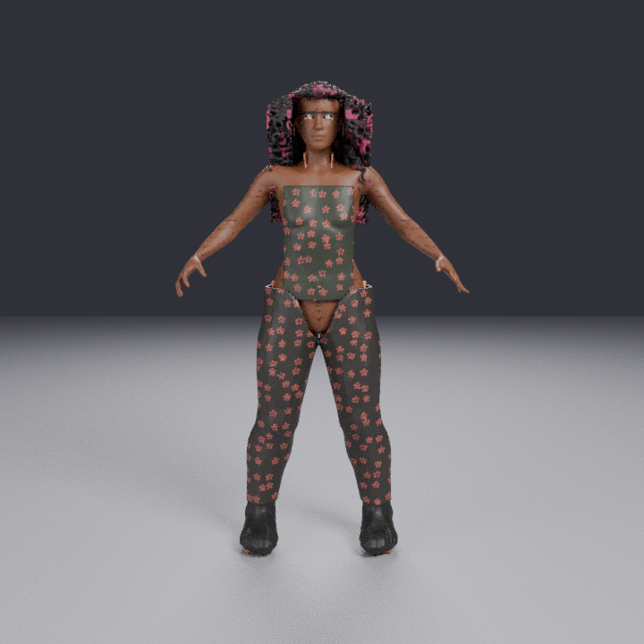
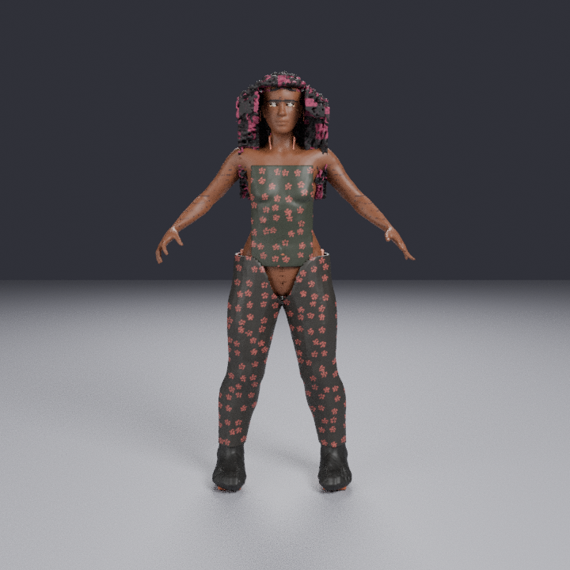
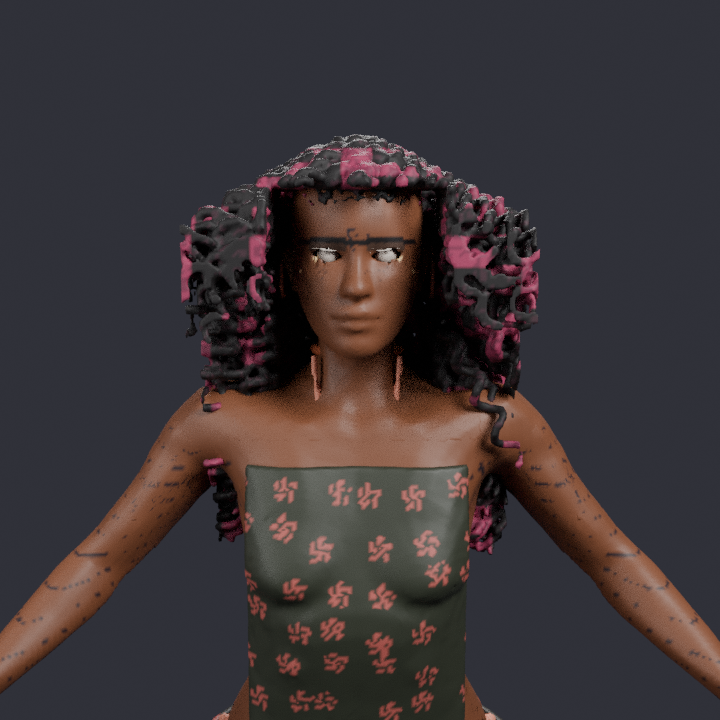
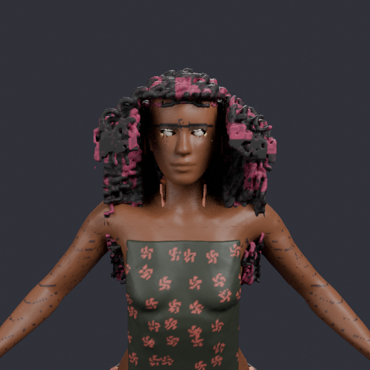
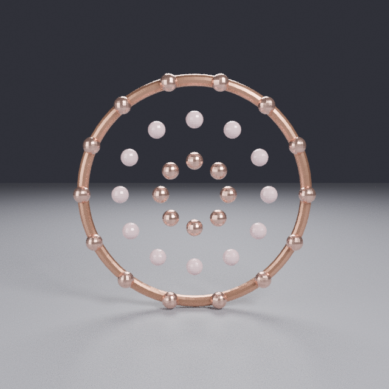
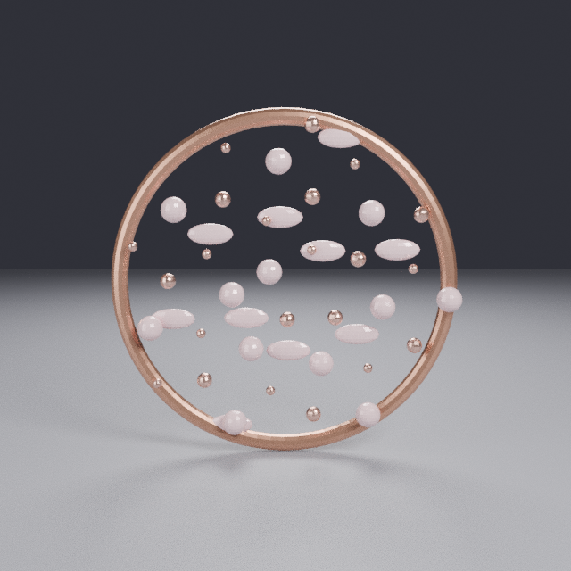
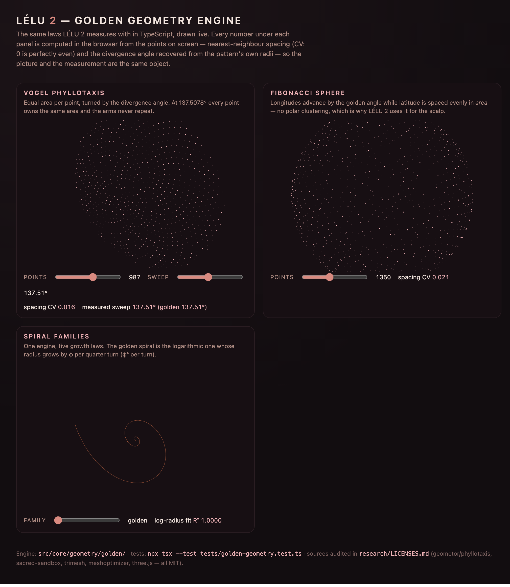

# LÉLU 2 — Golden Geometry — measured results

Everything below was produced in this branch (`experiment/lelu-2-golden-geometry`)
from her own canonical assets. Numbers are read from the build that wrote the GLB
and the render that was rendered from it; the JSON beside each asset is the
source of every figure.

* Source project: `lapheezy/LeluV1.1`, branch `claude/mission5-lelu-asre-integration-mm6xau`, **HEAD `55c89aae`** (untouched).
* LÉLU 2: linked worktree `lelu2/`, branch `experiment/lelu-2-golden-geometry`, first commit's parent = `55c89aae`.
* Isolation and inventory: [`LELU2_DUPLICATION.md`](../../LELU2_DUPLICATION.md).
* Sources, licences and revisions: [`research/LICENSES.md`](../../research/LICENSES.md), [`research/COMPATIBILITY.md`](../../research/COMPATIBILITY.md).

---

## 1. What was acquired and what it became

| Repository | Revision | Used as | Code taken |
|---|---|---|---|
| geometor/phyllotaxis | `a1eea285` | mathematics → reimplemented | short/long golden sweep, rational & Lucas divergence, growth-frame law, Fibonacci/Lucas integers |
| HollandRisley/sacred-sandbox | `d66f77d6` | mathematics → reimplemented | Vogel phyllotaxis, `π(3−√5)`, normalised golden spiral, sphere-emitter law |
| mikedh/trimesh | `7fe4ac44` | external validator | opens the GLBs LÉLU 2 writes and checks topology independently |
| zeux/meshoptimizer | `f0a684f1` | external measurement | JS/WASM simplifier, run offline in Node |
| three.js | `0.185.1` | already installed | live visualisation only |

All five are MIT. No upstream source is vendored; the engine is LÉLU's own
TypeScript and is verified against the published laws by 19 contract tests
(`npx tsx --test tests/golden-geometry.test.ts` → **19/19 pass**).

## 2. The engine

`src/core/geometry/golden/` — dependency-free, browser-safe, typechecked by the
project's own `tsc -b`:

* `constants` φ, 1/φ, golden angle 137.5078°, long sweep, Lucas angle, silver ratio
* `sequences` Fibonacci/Lucas, convergents, continued fractions, golden section, `closestPhiPower` (returns its own error)
* `phyllotaxis` Vogel disc, geometor growth frame, cylindrical phyllotaxis, parastichy pairs
* `sphere` Fibonacci sphere, spherical caps, pole-to-pole spiral, `selectSphericalEvenSubset` (area-even subset of real surface points), `mapDirectionsToSurface`
* `spirals` logarithmic/golden, Archimedean, Fermat, hyperbolic, lituus, conical ringlet, `spiralFit`
* `symmetry` radial, bilateral, recursive self-similar branching, φ ladders, angular spread
* `analysis` nearest-neighbour statistics, divergence signature, radial-law fit, n-fold and bilateral error, `geometricSignature`
* `proportions` pairwise landmark ratios vs φ powers, increment analysis, golden framing node
* `constraints` `selectConstraints` — accepts a relationship only if it is measured **and** useful

## 3. Character experiment — one variable

Both builds use the same assets, rig, anatomy targets and settings. The only
difference is `spec.geometry.golden`.

| | baseline | golden |
|---|---|---|
| hair root positions | the hair asset's own vertex distribution | area-even subset of her scalp surface (Fibonacci directions, golden-angle azimuth) |
| curl shape | constant-radius helix | golden logarithmic ringlet, radius decaying by 1/φ |
| bead work | — | 13 Fibonacci beads per hoop, sizes on a 1/φ ladder; chest cascade with φ-shrinking spacing |
| build time | 58.8 s | 59.9 s |
| peak RSS (child) | 837 MB | 837 MB |
| triangles | 1,373,624 | 1,389,588 (**+1.2 %**) |
| GLB | 43.7 MB | 44.2 MB |
| occupancy cells | 366,164 | 383,273 |
| hair triangles | 516,648 | 531,992 |
| **roots** | 928 | **1350** |
| **root spacing CV** | **1.345** | **0.643** (−52 %) |
| mean root spacing | 2.10 mm | 6.40 mm |
| closest root pair | 0 mm (coincident roots) | 0.17 mm |
| curl law | helix | golden spiral |

Renders (Cycles CPU, from the written GLBs, identical cameras):

| baseline | golden |
|---|---|
|  |  |
|  |  |

What the images actually show: the golden build's hairline is denser and more
even across the crown, and the baseline has visible gaps and stray locks at the
part. The ringlet taper is real geometry but reads subtly at 720 px — the curls
are still thick clumps because the hair is rasterised at a 2.5 mm voxel, so curl
detail below that is lost. **This is not a claim that her hair is finished.**

## 4. Ornament experiment — a real LÉLU accessory

`scripts/asre/lelu2/ornament.ts` builds a diadem in her metals with the same bead
count (34), the same disc, the same base ring and the same palette. Only placement
differs: concentric rings vs Vogel phyllotaxis with a 1/φ size ladder and petals on
a golden spiral.

| | baseline (rings) | golden (phyllotaxis) |
|---|---|---|
| bead spacing mean | 17.76 mm | 15.88 mm |
| **spacing CV** | **0.166** | **0.030** (5.5× more even) |
| max / min spacing | 1.68 | 1.16 |
| radial exponent (0.5 = equal area) | 0.432 | **0.490** |
| measured divergence | 27.5° | **137.5°** |
| petal spiral log-fit | — | **R² 1.0000**, φ⁴ = 6.854 per turn |
| triangles | 16,416 | 18,976 |
| GLB | 311 kB | 361 kB |

| baseline | golden |
|---|---|
|  |  |

## 5. Live visualisation

`public/golden/index.html` renders the Vogel disc, the Fibonacci sphere and five
spiral families with the same laws, and prints the spacing CV and recovered
divergence computed in the browser from the points on screen.

```bash
node public/golden/serve.mjs 3002     # → http://localhost:3002/
```



## 6. Independent validation

**Occupancy invariant** (`npx tsx scripts/asre/m58-iou.ts`) — her canonical build
is unchanged by this work:

```
per-component 329016 cells, whole-object 329016 cells
IoU 1.000000  (intersection 329016, union 329016)
procedural control: IoU 1.000000 (347914 vs 347914 cells)
```

**Topology** (`research/mesh-verify.py`, trimesh 5.2.1):

| file | nodes | faces | watertight nodes |
|---|---|---|---|
| `lelu2-baseline.glb` | 15 | 1,373,624 | 3 |
| `lelu2-golden.glb` | 15 | 1,389,588 | 3 |
| `ornament-golden.glb` | 3 | 18,976 | 0 (beads are separate closed shells) |

Both character builds are in the same topology class: no watertight node was lost
and none was gained, so the golden path did not introduce a defect — and it did
not repair one either.

**Mesh optimisation, measured separately** (`node research/meshopt-probe.mjs`):

```
source 4608 tris → 2303 tris (ratio 0.4998), relative error 0.000082, 5.6 ms
index bytes 55,296 → 27,636
```

That gain is meshoptimizer's, not the golden ratio's. It is reported here so the two
are never conflated.

## 7. Proportions — the honest answer

Her measured joint landmarks produce **4 of 111** pairwise ratios within 2 % of a
φ power (median relative error 0.158). At that tolerance a random body yields
comparably many by chance. Two ratios are genuinely close — `totalHeight/waistHeight
= 1.6015` (φ within 1.0 %) and `eyeHeight/shin = 4.192` (φ³ within 1.1 %) — but the
engine reports them as data and **does not** reshape her to make more appear.

The Fibonacci-count constraint was also rejected by the engine's own rule: her
1350 strands are 18 % from the nearest Fibonacci number (1597), which would change
how much hair she has, so `count.fibonacci` is marked `accepted: false` in both
metrics files. Golden geometry is adopted where it measurably helps and refused
where it would cost density.

## 8. What still does not work

* Ringlet detail is limited by the 2.5 mm hair voxel; V-shaped lock cross-sections
  are still coarse. A finer voxel or a swept-tube mesher is the next step, not a
  parameter change.
* Root CV is 0.643, not near zero: her scalp candidates come from a hair card that
  is denser at the part than at the edges, and the subset selection can only choose
  among points that exist. Densifying the candidate cloud further would improve it.
* No mobile or GPU performance was measured; the visualisation is desktop browser
  WebGL only.
* The ornament experiment is a standalone accessory asset, not yet attached to her
  head bone in the rig.
* Procedural environments, simulations and adaptive mobile projection were not
  attempted in this cycle — the report does not claim them.

## 9. Reproduce

```bash
npx tsx --test tests/golden-geometry.test.ts          # 19/19 engine contracts
npx tsx scripts/asre/lelu2/experiment.ts --variant baseline
npx tsx scripts/asre/lelu2/experiment.ts --variant golden
node scripts/asre/m58-render.mjs --dir artifacts/lelu2/golden --glb lelu2-golden.glb \
     --views front,three-quarter,back --size 720 --samples 24 --closeups --closeup face --closeup-views front
npx tsx scripts/asre/lelu2/ornament.ts
node research/meshopt-probe.mjs
PYTHONPATH=research/sources/trimesh python3 research/mesh-verify.py artifacts/lelu2/golden/lelu2-golden.glb
npx tsx scripts/asre/m58-iou.ts
```
