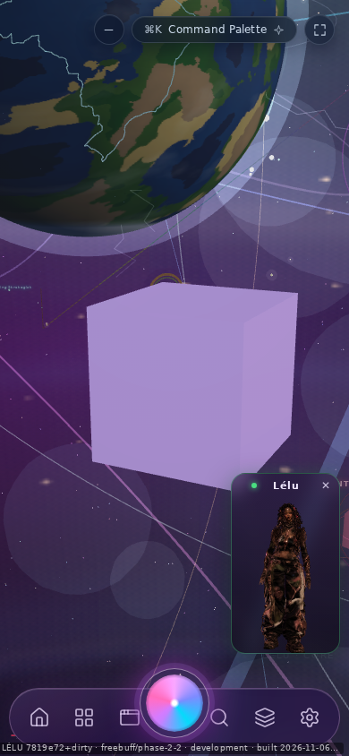
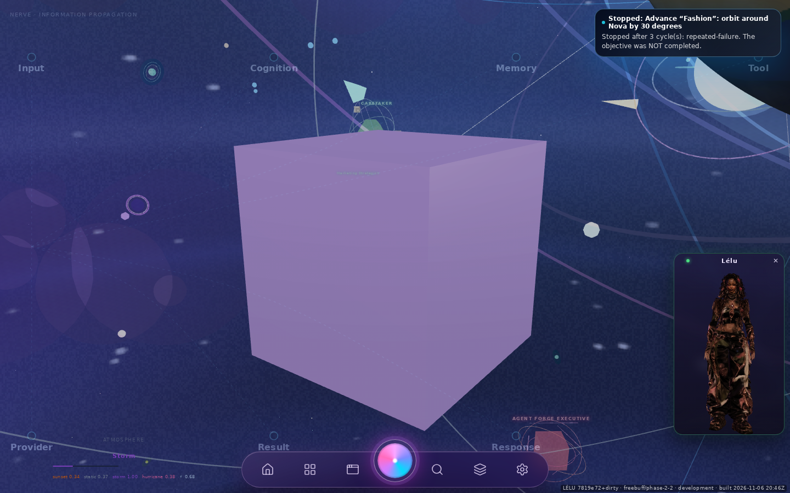

# LÉLU V1.1 — Phase 2.6: Genesis world continuity and visible object acceptance

Branch `freebuff/phase-2-2`, continuing from Phase 2.5 (`7819e72`). No architecture
was replaced: one `SpatialSceneGraph`, one R3F canvas, one camera, one interface.

**Headline:** a cube created through chat now survives the surface change and is
**seen** — not merely reported — inside the live Genesis world at 390×844,
375×812 and 1440×900, still there after reopening chat, and still there after a
camera command.

## 1. Why chat did not reveal the world

Traced, not guessed:

1. Spatial meshes render inside the **v1 canvas** (`GenesisRenderer` → `SpatialLayer`)
   — there is no second renderer.
2. On a phone the surface router **unmounts the world** while chat owns the screen
   (`!surface.cosmosRendered ? null` in `GenesisScene`). On desktop the Chat
   Universe covers it and `getSceneRenderBudget().setOccluded("chat-universe", …)`
   pauses the canvas.
3. Closing chat sets `activePanel` to `"none"`, and `CosmosHome` renders when
   `activePanel === "none" && !HomeStore.immersive`. So the dashboard painted over
   the world — that is the Phase 2.5 capture with no cube.
4. Nothing connected a spatial commit to the surface: the scene cannot change the
   surface, and the interface never touched the graph. That missing signal is the
   real cause; the graph, camera and persistence were already correct.

## 2. What changed

### 2.1 A reveal signal from the scene to the interface
`SpatialRevealIntent` records the object ids/names of a **verified** create/commit.
Rolled-back commits never request a reveal. This is identity only: no rendering,
no camera, no surface policy.

### 2.2 Chat closes onto the world, not the dashboard
`SpatialRevealBridge`, mounted once in the canonical interface, sets
`HomeStore.immersive` when a reveal exists and chat closes (both the Universe
overlay and the plain chat panel paths). Chat is **not** closed by the creation —
the Phase 2.5 multi-message session still works. The Home navigation still
returns to the dashboard (`goHome` clears immersive); reopening chat resumes the
same conversation and the same scene.

### 2.3 The created object is framed, deterministically
When the world is genuinely on screen (no chat panel, no Universe overlay), the
bridge asks the **existing** camera intent to focus the object with a deliberate
three-quarter direction (`[0.55, 0.35, 1]`, padding 1.25) instead of inheriting
whatever angle the camera happened to have. Failed flights are retried (3×), and
the reveal holds the camera takeover until the user goes back to chat, so
autonomous exploration cannot steal the shot.

### 2.4 Verification no longer certifies a camera that never left
`settleCamera()` only accepted "has stopped moving", which is true in the first
frames after a fly is dispatched. It now waits for the **requested pose**
(≤ 0.35 units, held 180 ms). Reveal reports read `camera pass, framing pass`.

### 2.5 The camera is not recentred while it is held
The v1 controller lerped `controls.target` to the origin every frame whenever the
target was within 4 units of the planet centre, sliding a freshly framed object
out of the middle of the screen. That drift now runs only while the camera is not
held (gesture or spatial takeover) — matching what the file already claimed about
user camera work.

## 3. The demonstrated sequence

Per viewport, all through the real composer and the real close control:

1. `create a cube called Nova` → `Created "Nova" (box) at (2.2, -1.35, 2.2).
   Scene revision 1 — 1 object.`
2. Close chat → the Genesis world appears framed on Nova (no dashboard).
3. `what is in the scene` (after reopening chat) → `Scene revision 1: 1 object —
   "Nova" (box) at (2.2, -1.35, 2.2).` — same identity.
4. `orbit around Nova by 30 degrees` → `Orbited 30° around "Nova" … No scene
   object changed.` (revision stays 1).
5. Close chat again → the world returns framed on the **same** object.

### Measured evidence

| Viewport | First reveal: camera / target | Verification | Nova pixels (share of screen) | After reopen: pixels | Image |
| --- | --- | --- | --- | --- | --- |
| 390×844 | `(4.30, −0.01, 6.02)` → `(2.20, −1.35, 2.20)` | camera pass, framing pass | **46,037** (14.0 %) | **46,120** (14.0 %) | `screenshots/390x844-03-world-nova.png`, `…-06-world-after-reopen.png` |
| 375×812 | `(4.30, −0.01, 6.02)` → `(2.20, −1.35, 2.20)` | camera pass, framing pass | **39,729** (13.1 %) | **38,670** (12.7 %) | `screenshots/375x812-03-world-nova.png`, `…-06-world-after-reopen.png` |
| 1440×900 | `(2.55, −0.58, −0.61)` → `(1.34, −1.35, −2.81)` | camera pass, framing pass | **185,356** (14.3 %) | 5,066 counted, **full cube visible in the capture** | `screenshots/1440x900-03-world-nova.png`, `…-06-world-after-reopen.png` |

Pixel counts come from the actual screenshot: pale lavender lit faces
(`averageColour ≈ [166, 141, 204]`) counted in the world band, then cropped and
upscaled (`*-crop.png`). `rendered: true` from the scene probe was never treated
as proof.

The 1440 return capture counts fewer matching pixels than the first (different
lighting and a slightly different angle as the cosmos orbited and Nova's **world**
position drifted: `(1.15, −1.35, −2.89)` → `(−2.48, −1.35, 1.88)`; its local
position stayed `(2.2, −1.35, 2.2)`). The screenshot shows the cube fully and
centrally at 1440×900; the detector undercounts it there, and that is reported
rather than smoothed over.

## 4. Status by requirement

| Requirement | Status |
| --- | --- |
| Trace the transition (unmount / pause / home) | **Verified** — cause is the missing scene→surface signal, documented above |
| Object identity, transforms, scene data preserved | **Verified** — revision 1 throughout, same name/kind/local transform |
| Relevant camera state preserved | **Verified for the revealed object** — the world reopens framed on it; the reveal holds the takeover |
| Transition chat → Genesis world | **Verified** on all three viewports |
| Nova visibly displayed, distinguishable | **Verified by pixels** on all three viewports |
| Continue manipulating it | **Verified** — `orbit around Nova by 30 degrees` dispatched and measured; scene unchanged |
| Nova visible after closing chat | **Verified** |
| Nova visible after reopening chat | **Verified** — second reveal, same object |
| No recreated scene / no duplicate renderer | **Preserved** — one graph, one canvas, one camera |
| Chat reachable again, same scene | **Verified** — transcript in `04-chat-scene.png`, revision 1 |
| iPhone composer accessible | **Verified** — messages typed at 390×844 and 375×812 |
| Phase 2.5 behaviour | **Preserved** — see gates; chat is not auto-closed by a creation |

## 5. Limits, stated plainly

* While chat owns a phone screen the world is unmounted by design, so a camera
  command issued **from chat** reports `verification: graph only (camera … not
  measurable here)`. That is truthful, and it is why camera framing is verified
  after chat closes.
* The 1440 return pixel count is not comparable to the first (see §3); the visual
  evidence is.
* Viewport emulation, not a physical iPhone. Sign-in skipped through the existing
  "continue without an account" action.
* Companion toasts (`Stopped: Advance “Fashion” …`) appear over some captures;
  they are the proactive engine reacting to the same typed sentence, not part of
  this transition.

## 6. Gates

| Check | Result |
| --- | --- |
| `bun run typecheck` | exit 0 |
| `bun run test tests/spatial-reveal.test.ts …` (tsx, `node:test`) | **51 pass, 0 fail** |
| `bun run lint` | **0 errors**, 108 warnings (unchanged) |
| `bun run test` (the project's runner) | **1389 pass, 1 fail, 6 skip** — the single failure was this phase's `tests/spatial-reveal.test.ts` importing `bun:test`, fixed in Phase 2.7 |
| Playwright | 3 viewport runs, 3 traces, no page error or crash |

**Correction (Phase 2.7):** an earlier version of this table reported
`bun test` — **1334 pass / 38 fail / 6 skip** — and attributed the 38 failures to
pre-existing product bugs. That was wrong. `bun test` is not this project's test
command; the suite is `bun run test` (`tsx --test` with `tests/support/ignore-css.mjs`,
tests import `node:test`). Under the real runner those 38 were the same files
passing, and the only genuine failure was the one introduced here. Corrected
numbers and the full explanation are in
[`../spatial-phase-2-7/REPORT.md`](../spatial-phase-2-7/REPORT.md) §4.

## 7. Files

Modified:
* `src/core/spatial/SpatialIntentBus.ts` — reveal request after verified commits; settle on the requested pose
* `src/core/spatial/SpatialCameraApplier.ts` — explicit framing direction
* `src/core/spatial/SpatialTypes.ts` — `camera.focus.direction`
* `src/app/scene/genesis/GenesisCameraController.tsx` — no target recentring while the camera is held
* `src/app/scene/genesis/GenesisInterface.tsx` — mounts the reveal bridge

Added:
* `src/core/spatial/SpatialRevealIntent.ts`
* `src/app/scene/genesis/spatial/SpatialRevealBridge.tsx`
* `tests/spatial-reveal.test.ts`
* this directory (`REPORT.md`, `environment.md`, `test-results.json`, per-viewport
  JSON with every step, `screenshots/`, `traces/`)
