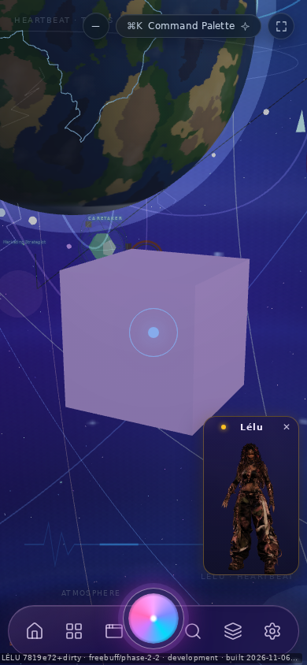
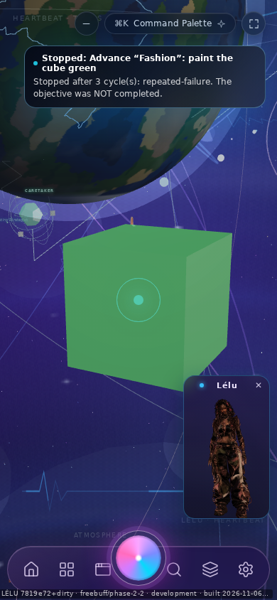

# LÉLU V1.1 — Phase 2.7: every scene change is shown, and actually drawn

Continues Phase 2.6 (`f350221`). No new renderer, no new camera, no new surface
system: the same one canvas, one graph, one camera intent.

**Headline:** the reveal is no longer only for creations. Any verified change to
the scene — move, resize, rotate, recolour, show/hide, a composed commit — now
brings the world back framed on its subject. Building the proof exposed a real
rendering bug: objects carried a fixed violet `emissive` (`#a78bfa`), so a
recoloured object committed `#22c55e`, reported it, and still painted violet.
Fixed, and measured: **0 → 46,863 green pixels**.

## 1. What was extended

`SpatialIntentBus` asked for a reveal only on `object.create` / `scene.commit`.
A user asking chat (or voice, or the palette) to move or repaint something got a
truthful reply about an object they could not see. Now, after verification
passes:

```ts
if (intent.op !== "object.delete" && attention) {
  SpatialRevealIntent.getInstance().request([attention.id], [attention.name]);
}
```

Deletes are excluded on purpose — there is no subject left to frame — and a
refused/rolled-back change still asks for nothing, so a failed command never
moves the surface.

Every product creation and edit path routes through this bus (`SpatialResolver`
covers chat/voice/palette phrasing; `SpatialComposition` commits through it), so
the rule is enforced in one place rather than per surface.

## 2. The bug the extension exposed

`SPATIAL_DEFAULT_MATERIAL` sets `emissive: "#a78bfa"` (pale violet) at
`emissiveIntensity: 0.35`, and the presence highlight adds `+0.65` while an
object is being attended to — exactly when the reveal frames it.

So "paint the cube green" went:

| Layer | Value |
| --- | --- |
| graph after commit | `material.color = #22c55e`, revision 3 |
| mesh probe after close | `color: "#22c55e"` |
| render model | `color: "#22c55e"` |
| **published frame** | `(175,165,217)` — still lavender |

The base colour changed and the violet glow did not, so the object looked
unchanged. Fix: a colour change carries the glow with it, the same convention
`SpatialComposition` already uses (`emissive: color`), unless the caller asked
for a specific glow:

```ts
patch.color = color;
if (intent.emissive === undefined) patch.emissive = color;
```

This is a product fix, not a test accommodation. `tests/spatial-reveal.test.ts`
now asserts both `model.color` and `model.emissive`, because asserting only the
colour would have passed while the screen stayed violet.

## 3. Evidence

Viewport `390×844` (phone: the world is unmounted under chat, so it must be
remounted from the graph — the hardest case). Evidence in this directory.

### 3.1 A change to an existing object is shown

`make Nova bigger` → `Resized "Nova" to 1.5× its base size. Scene revision 2.`
then `inspect Nova` → `scale (1.5, 1.5, 1.5)`. Closing chat re-framed the same
object:

| Field | Value |
| --- | --- |
| reveal | `Framed "Nova" — camera at (5.38, 0.65, 7.9) … camera pass, framing pass` |
| revision | 2 |
| pixels | 7,969 lavender, bbox 317×356 |
| files | `screenshots/390x844-08-world-after-resize.png`, `390x844-07-chat-inspect.png` |

Honest caveat: the reveal frames with constant padding, so a 1.5× object is
drawn at roughly the same screen size (camera distance grew 4.3 → 5.38). The
resize is proven by the scale readout and the farther camera, not by a bigger
bounding box.

### 3.2 A recolour is shown *and* looks different

| | Before painting | After painting |
| --- | --- | --- |
| command reply | — | `Changed "Nova" — colour #22c55e. Scene revision 2.` |
| green pixels | **0** | **46,863** |
| lavender pixels | 47,508 | 489 |
| centre pixel | `(165, 140, 203)` | `(82, 200, 171)` |
| green bbox | — | 89, 316, 237×233 |
| reveal | — | `Framed "Nova" — camera at (4.3, −0.01, 6.02) … camera pass, framing pass` |

Files: `screenshots/390x844-11-recolour-before.png`,
`screenshots/390x844-12-recolour-after.png`,
`screenshots/390x844-12-recolour-after-crop.png`, measurements in
`390x844-recolour.json`.





The green count is measured from the published PNG (green channel dominant in
the world band), not from the scene graph. The first capture attempt in an
earlier run returned a stale paint; the focused script re-captures after real
animation frames until the green channel is on screen or reports that it never
arrived (`greenSeen`), which is why the "before" shot is included rather than
trusted.

## 4. The pre-existing failures — they were a measuring error

The Phase 2.5/2.6 baseline of "1329 pass / 38 fail / 6 skip" came from running
`bun test`, which is **not** this project's test command. The project runs
`bun run test` → `tsx --test` with `tests/support/ignore-css.mjs` (the tests
themselves import `node:test`). Those 38 failures were `bun test`'s
`node:test` compatibility path, not product bugs: the same files report
`ReferenceError: indexedDB is not defined` there and pass under the real runner.

Measured with the correct command:

| Run | Result |
| --- | --- |
| `bun run test` before this phase | **1389 pass, 1 fail, 6 skip** |
| the 1 real failure | `tests/spatial-reveal.test.ts` — *my* Phase 2.6 file imported `bun:test` (`ERR_UNSUPPORTED_ESM_URL_SCHEME`) |
| `bun run test` after | **1399 pass, 0 fail, 6 skip**, exit 0 |

The test file was rewritten to the repo's `node:test` convention, and the Phase
2.6 report/JSON gates were corrected to the real runner. Nothing was skipped,
`.skip`-ed, or loosened to get there; `typecheck` (exit 0) and `lint`
(0 errors, 108 warnings) are unchanged.

## 5. Limits

* **Not verified on a physical iPhone.** Viewport emulation only, signed in as
  the guest ("continue without an account").
* **Voice and the dashboard were not driven end-to-end.** They were not
  exercised in the browser (no microphone, and the dashboard has no spatial
  creation control); what is verified is that the rule lives at the one bus every
  path calls, plus bus-level tests for each operation. A voice-path UI test
  remains open.
* The 390×844 pass issued camera commands from chat, so the reply itself says
  `graph only (camera … not measurable here)` — the world is unmounted under
  chat there by design. Framing is verified after chat closes.
* The proactive engine reacts to the same typed sentence (`Stopped: Advance
  "Fashion": paint the cube green`) and its toast overlays the world in
  captures; unrelated to this transition.
* Full-suite wall time is ~3 minutes; the single-command cap is 290 s, so the
  browser evidence is split into the multi-step run (`390x844.json`) and the
  focused recolour run (`390x844-recolour.json`).

## 6. Files

* `src/core/spatial/SpatialIntentBus.ts` — reveal on every verified mutation
  except delete; a colour change carries the emissive
* `tests/spatial-reveal.test.ts` — rewritten for `node:test`; 10 tests covering
  identity, the create/move/resize/recolour reveals, delete exclusion, rollback,
  and the drawn material
* `docs/acceptance/spatial-phase-2-6/` — gate numbers corrected to `bun run test`
* this directory — per-step JSON, recolour measurements, screenshots
