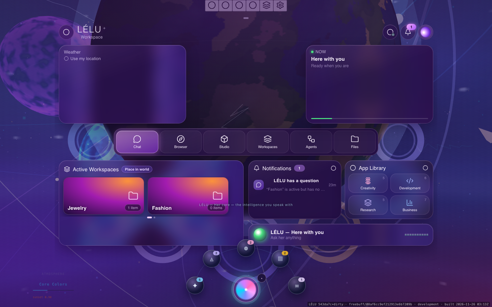
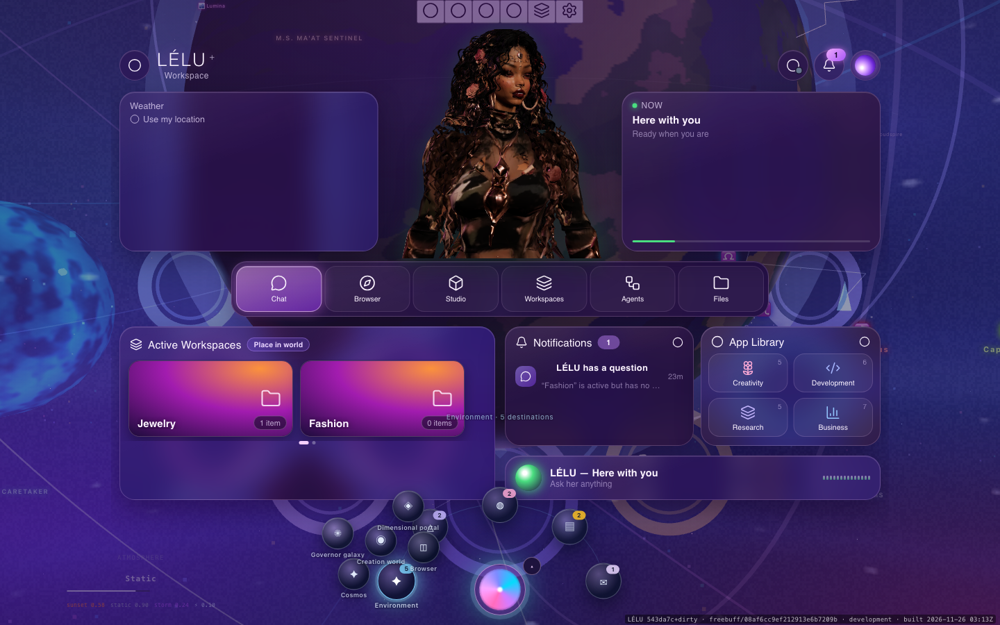
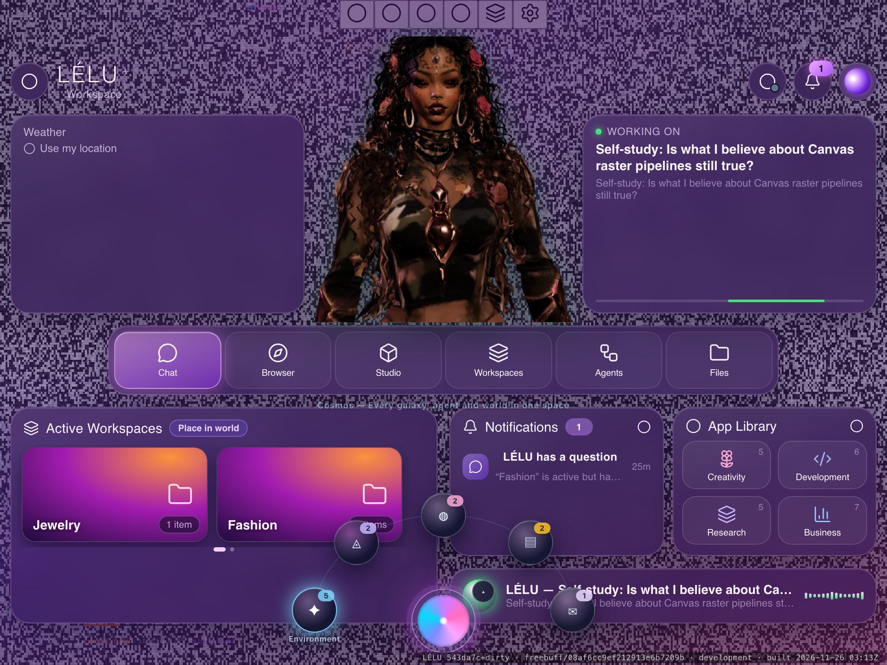
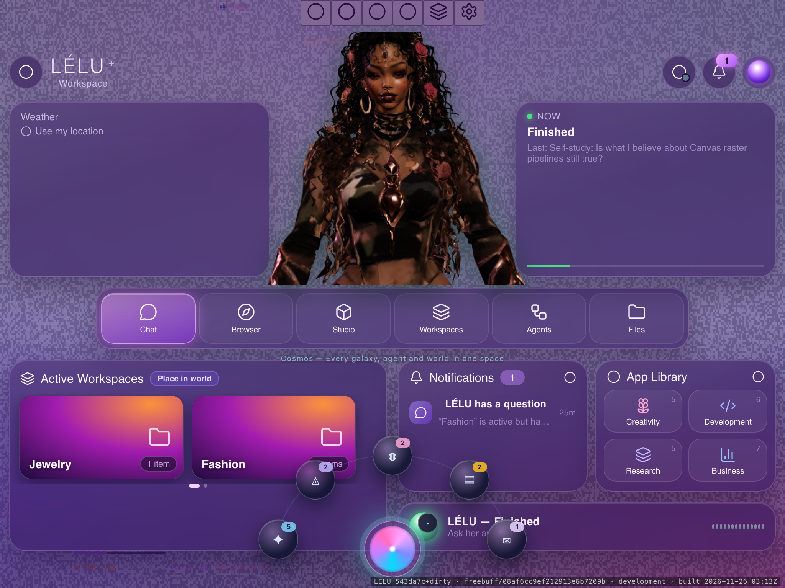
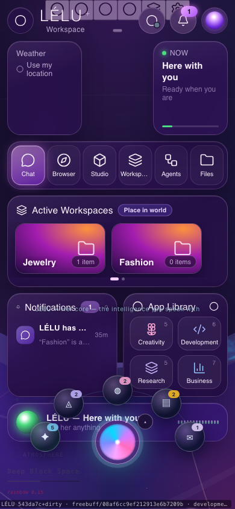
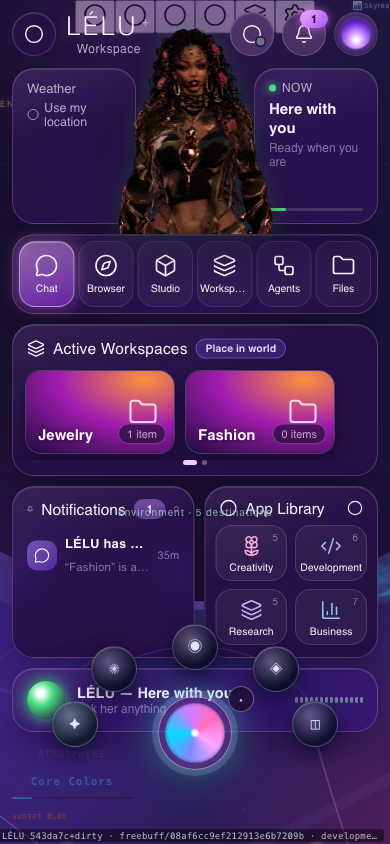

# Mission 41 — LÉLU Self-Awareness, Cosmos Navigation & Continuous Improvement

Branch `freebuff/08af6cc9ef212913e6b7209b`, HEAD `543da7c` (all work uncommitted in the working tree).

---

## 1. Root causes

**Navigation.** The Cosmos navigation was a horizontal strip of pill tabs (`.lsn*`) laid across the
bottom of the world: full-viewport-width, glass, ~44px pills with text labels. It read as a toolbar
floating over the Earth rather than as LÉLU's orbit. Every orb used the same slot, so items wrapped,
overlapped and covered the world. Nothing in it was geometrically anchored to the Core.

**Self-awareness.** The systems were *disconnected*, not wrong:

- `CapabilityRegistry` knew subsystem states, but nothing mapped a capability to the files and
  checks that prove it, so "implemented" could only ever be inferred from a commit or a claim.
- `ImprovementQueue` was append-only. `SelfDevelopmentEngine` re-derived proposals on every scan,
  `hasOpenSimilar` compared titles only, and a proposal that had been integrated kept its
  `Integrated` status forever while a *new* proposal for the same gap could still be added.
- `SelfModel` held a snapshot of limitations written at boot and never compared it to the work that
  had since landed. Resolved limitations stayed in the prompt and in notifications.
- `StartupDiagnostic`, `SelfDevelopmentEngine`, notifications and `CognitiveContext` each read a
  different subset of that state, so the same fact could be "operational" in one and "missing" in
  another. There was no development memory: missions, upgrades and verifications were not a source
  of truth for anything.

---

## 2. Existing architecture findings

| Layer | What it is | What it gave us |
| --- | --- | --- |
| `src/app/scene/spatial/SpatialNavigator.tsx` | the Cosmos nav, `data-spatial-*` hooks, travel via `SpatialExperience` | the place to rebuild the orbit; travel, progress and transitions already existed |
| `src/app/scene/spatial/capabilityGroups.ts` | `dockGroups()` — 5 groups → destinations, labels, hints, accents | the single source for categories; the orbit is derived from it, never hand-authored |
| `src/core/selfdev/ImprovementQueue.ts` | persisted proposals + status workflow | had to keep working; the lifecycle was added *beside* `status`, not instead of it |
| `src/core/selfdev/SelfDevelopmentEngine.ts` | detect / propose / execute loop | reconcile point for a scan |
| `src/core/selfdev/StartupDiagnostic.ts` | boot-time capability check | reconcile point for boot |
| `src/core/cognition/SelfModel.ts` | the limitations/capabilities text put in LÉLU's prompt | corrected in place instead of replaced |
| `src/core/cognition/CognitiveContext.ts` | prompt assembly | now carries a self-awareness section |
| `src/app/scene/genesis/GenesisNotificationsPanel.tsx` | "she has a question" list | now lifecycle-aware |

---

## 3. Files and components changed

**New**

| File | Role |
| --- | --- |
| `src/app/scene/spatial/orbitLayout.ts` | pure orbit geometry: `orbitRing`, `satelliteOffsets`, `orbitBounds`, `adjacentGap`, `pointAt` |
| `src/core/selfdev/CapabilityEvidence.ts` | capability → implementation files + named checks; `RESOLVED_LIMITATIONS` |
| `src/core/selfdev/ImprovementLifecycle.ts` | 9 lifecycle states, `decideLifecycle`, `reconcileImprovements` |
| `src/core/selfdev/DevelopmentJournal.ts` | `MISSION_LEDGER` + journal built from versions, executions, memory and daily upgrades |
| `src/core/selfdev/SelfAwareness.ts` | `assess`, the 8 answers, `reconcile`, `describe` |
| `src/core/selfdev/ImprovementCycle.ts` | identify → compare → prioritize → execute → verify → journal → reassess |
| `tests/spatial-orbit.test.ts` | orbit geometry, no pill markup, touch targets, destination fan |
| `tests/self-awareness.test.ts` | evidence, lifecycle, dedupe, reopen-on-regression, journal, her 8 answers |
| `scripts/capture-mission-41.mjs` | reproducible capture of the running app |

**Edited**

`SpatialNavigator.tsx`, `spatialNav.css`, `ImprovementQueue.ts`, `SelfDevelopmentEngine.ts`,
`StartupDiagnostic.ts`, `SelfModel.ts`, `CognitiveContext.ts`, `GenesisNotificationsPanel.tsx`,
and a one-line `Number.isFinite` guard in `FeatureUnderstanding.ts` (a pre-existing typecheck
blocker in an unrelated file).

---

## 4. The orbital navigation

- **Anchor.** LÉLU Core sits at the bottom centre of a fixed 430px band. It never moves; it carries
  the progress ring and returns you home.
- **Categories.** Five orbs derived from `orbitRing(5)` — an ellipse (`--orbit-rx`
  `clamp(102px, 30vw, 150px)`, `--orbit-ry` `clamp(88px, 23vw, 122px)`). Positions depend only on
  the *count*, so travelling never moves an orb. 52px orbs, 0 overlaps, hairline ring showing the
  path.
- **Destinations.** Opening a category fans its destinations out around it
  (`satelliteOffsets`): 46px orbs on a tilted fan with alternating radii, never dropping below the
  category. Selecting one travels and closes the fan.
- **Compact.** On a phone the band cannot hold the ring *and* a second constellation, so the open
  category's destinations take the ring's own slots and the categories step back. Nothing sits on
  top of a tappable orb; the Core returns.
- **Everything else survived**: `data-spatial-*` hooks, portal sheet, `SavedWorlds compact`,
  the utility arc (`voice/creation/portals/chat/minimise`), transit controls, saved worlds, the
  sign-in gate hiding the band.

Measured on the running app (see `evidence/mission-41/measurements.json`):

| | desktop 1440×900 | phone 390×844 |
| --- | --- | --- |
| band | 430×292 (30% of width) | 374×264 (96%) |
| category orbs | 5 × 52px, 0 overlaps | 5 × 50px, 0 overlaps |
| destinations | 5 × 46px, 0 overlaps, in view | 5 × 46px on ring slots, 0 overlaps, in view |
| covers Core | no | no |
| travel → cosmos → return | `cosmos` then `core` | — |

---

## 5. Self-awareness synchronisation

`CapabilityEvidence` is the missing link: a capability counts as **operational** only when its
implementation files *and* its named checks exist on disk. A test asserts every declared path
exists, so the table cannot drift into fiction. `RESOLVED_LIMITATIONS` records limitations that
were closed, with the mission that closed them and the evidence.

`SelfAwareness.assess()` answers the eight questions from that evidence, the registry, the journal
and the queue — not from a commit. `SelfModel.reconcileFromAwareness()` then *corrects the model in
place*: resolved limitations are removed, still-true ones and other systems' evidence lines are
preserved, and managed improvement lines are prefixed `Improvement: ` so nothing foreign is swept
away. `CognitiveContext` carries the result into the prompt, so what she says about herself comes
from the same reconciliation the panel shows.

## 6. Reconciled improvement records

Nine states (`Identified, Planned, In progress, Implemented, Verification pending, Verified
complete, Blocked, Superseded, Reopened`) live beside the existing `ImprovementStatus`, so persisted
proposals and old tests keep working.

`reconcileImprovements` runs at boot, on every scan, and when the notifications panel opens:

- same-topic proposals **collapse** into the oldest, which keeps the work;
- an implemented-but-unverified proposal becomes **Verification pending**, not complete;
- a superseded capability (evidence says it is available *and* verified, or its title is in
  `RESOLVED_LIMITATIONS`) moves to **Superseded** and leaves the active queue, keeping its history;
- a verified proposal that later loses its evidence **Reopens** — and only then;
- `open()` returns active work only, with reopened work actionable again;
- `archived()` keeps every retired record reachable without polluting the queue.

## 7. Journal integration

`DevelopmentJournal` is development memory, not notes: mission records from `MISSION_LEDGER`
(mission 16, 17, 41), improvements from the queue, verifications from `executions`, upgrades from
memory and daily entries. Each entry carries its mission, its evidence and its commit where known,
so "why is this considered done?" is answerable from the journal alone. Reconciliation reads it, so
a completed mission cannot be re-recommended as new work.

---

## 8. Screenshots (from the running app)

---

## 9. Test results

| Run | Result |
| --- | --- |
| `tests/spatial-orbit`, `spatial-experience`, `spatial-dock-groups`, `saved-worlds`, `home-layout-overlap`, `self-awareness` | 47 / 47 pass |
| `npx tsc -b --force` | pass |
| `npm run build` | pass (`✓ built in 5.54s`) |
| `npm test` (full suite, 2,287 tests) | 2,278 pass, 1 file fails to load |

The one failure is `tests/genesis-interface.test.tsx`, which cannot import
`@excalidraw/excalidraw/index.css`: Node's resolver does not set the `development`/`production`
conditions that package's export map requires. The import line dates from 7 November (commit
`dacf192`) and the dependency matches the lockfile — it is unrelated to this mission and fails
without these changes.

## 10. Remaining limitations

- The captured desktop view still shows the home surface's own quick-link row; it belongs to the
  home scene, not to the orbit, and was not in scope.
- On a phone the destinations replace the rings' slots; switching category requires returning to the
  Core first (a second tap on the hidden ring is not offered).
- Capability evidence is a curated table: a capability only becomes "operational" once someone adds
  its files and checks. That is deliberate (no commit inference) but it means new work needs a line
  added here.
- Reconciliation is conservative: a proposal is only superseded when its evidence is available *and*
  verified, or when it matches a recorded resolved limitation. Anything ambiguous stays in the
  queue rather than being silently retired.
